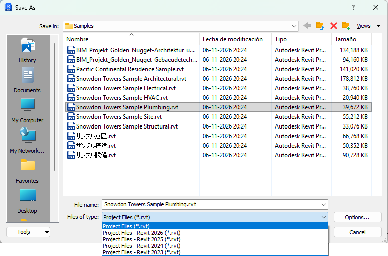

# Version Bridge for Revit

**Save Revit files to earlier versions, and open files from newer versions, from Revit's own Open and Save As.**

> **Pre-release:** Version Bridge is being tested. Keep your original files and check every converted copy, and
> please [report any problem](#reporting-a-problem). Watch this repository to be notified of new releases.

Version Bridge is an add-in for Autodesk Revit on Windows. It adds earlier versions to Revit's **Save As** dialog
and, when you open a file saved by a newer Revit, offers to convert a copy to your version. Elements stay native and
editable: walls stay walls, families stay families. Nothing is turned into imported geometry.

**Español:** [README.es.md](README.es.md)



*Screenshot from Revit 2027*

## What it does

- **Save As an earlier version.** In Save As, the **Files of type** list shows one entry per earlier version, for
  example *Project Files - Revit 2023 (\*.rvt)*. Choose one, and Version Bridge writes a copy in that version.
- **Open files from newer versions.** When Revit refuses a file saved by a later version, Version Bridge offers to
  convert a copy to your version and open it. By default the copy is saved next to the original as
  `<name>_rvt<year>.rvt`, or you can choose where to save it.
- **The original never changes.** Both features write a separate copy. The copy cannot replace the original file.
- **Projects, families and templates:** `.rvt`, `.rfa`, `.rte` and `.rft`. Family templates (`.rft`) are offered
  next to `.rfa` in Save As > Family.
- **No silent losses.** Each conversion is checked before anything is written. If the file contains data that would
  be dropped and has not been validated as safe to drop, the copy **is not saved**, and Version Bridge tells you why.
- **Local.** Models are converted on your computer and are never uploaded.

## Supported versions

Version Bridge runs in **Revit 2023, 2024, 2025, 2026 and 2027** on 64-bit Windows.

| File saved in | Can be converted to |
| --- | --- |
| Revit 2027 | 2026, 2025, 2024, 2023 |
| Revit 2026 | 2025, 2024, 2023 |
| Revit 2025 | 2024, 2023 |
| Revit 2024 | 2023 |

Revit 2023 is the earliest target, so in Revit 2023 Version Bridge only opens newer files.

## 60-day trial

This pre-release works for **60 days on each computer**, counted from the first time Version Bridge is used on it.
Seven days before the trial ends, Version Bridge shows a notice with the date. When the trial ends, Save As is Revit's
own again and newer files are refused as usual. New versions are published on the
[Releases](https://github.com/SpeedCAD/Version_Bridge_for_Revit/releases) page.

## Not supported

- **Workshared models** (central and local files) and **cloud models**: Save As stays Revit's own.
- **Versions earlier than Revit 2023.**
- **Unsaved changes:** the copy is made from the file on disk. If the model has unsaved changes, Version Bridge offers
  to save it first.

## Limitations

Each Revit release adds features that earlier releases do not have. When converting to an earlier version:

- Data that the target version cannot hold is removed. When the copy is saved, Version Bridge shows only where it
  was saved. The removals are reported only when the copy is not saved, in its log (see
  [Reporting a problem](#reporting-a-problem)).
- Some features cannot be converted at all, for example toposolids when saving to Revit 2023. In that case the
  copy is not saved.

**Keep the original file** and check the converted copy before using it in production: geometry, hosted elements,
families, parameters, schedules, annotations and sheets.

## Download and installation

Download the installer only from [GitHub Releases](https://github.com/SpeedCAD/Version_Bridge_for_Revit/releases):
open the latest release and, under **Assets**, download the `.exe` file. Do not download installers that claim to
be official from any other source.

### Install

1. Close Revit.
2. Run the installer. It does not need administrator rights: it installs for your Windows user only.
3. Accept the license agreement.
4. Choose the Revit versions. Every Revit 2023–2027 installed on the computer is listed and checked.
5. Start Revit. The first time Version Bridge loads, Revit may ask whether to load an add-in that is not signed.
   Choose **Always Load**.

The add-in is installed in `%AppData%\Autodesk\Revit\Addins\<year>`: the `sc_versionbridge.addin` file and the
`SCADtools.VersionBridge` folder.

### Windows SmartScreen warning

The installer is not yet code-signed, so Windows does not know its publisher. Your browser may say that the file
"isn't commonly downloaded", and when you run it Windows may show **Windows protected your PC** with
**Unknown publisher**:

- In the browser (Edge), choose **Keep** in the download menu (**...**), then **Show more** > **Keep anyway**.
- In the SmartScreen window, choose **More info**, check that the app is *Version Bridge for Revit*, and choose
  **Run anyway**.

Do this only with the installer downloaded from this repository's Releases page. To check that the file is the one
we published, compare its SHA-256 hash with the one in the release notes. In PowerShell:

```powershell
Get-FileHash "$env:USERPROFILE\Downloads\<installer file>.exe" -Algorithm SHA256
```

### Update

Close Revit and run the installer of the new version. It replaces the previous one; there is no need to uninstall
it first.

### Uninstall

1. Close Revit.
2. Open **Settings** > **Apps** > **Installed apps** (in Windows 10: **Apps & features**).
3. Find **Version Bridge for Revit**, choose **...** > **Uninstall**, and confirm.

This removes the add-in from every Revit version where it was installed. The converted copies you saved and the logs
in `%LOCALAPPDATA%\SCADtools\Version Bridge` are not deleted; you can delete that folder by hand.

## Reporting a problem

Open an [issue](https://github.com/SpeedCAD/Version_Bridge_for_Revit/issues/new/choose) with the **Conversion
problem** template. It asks for:

- the Revit version you used, the version of the file and the target version;
- the file type (`.rvt`, `.rfa`, `.rte` or `.rft`);
- what you expected and what happened.

When a conversion fails, Version Bridge writes two logs. Please attach them:

- `%LOCALAPPDATA%\SCADtools\Version Bridge\versionbridge.log`
- `<name>.log.txt`, next to the copy that was not saved: the full conversion report.

The logs contain file paths and element names. Review them before attaching them to a public issue.

**Do not upload confidential models, drawings or client data to public issues.** If the problem only happens with a
model you cannot share publicly, you may send it to **scadtools.software@gmail.com** as a download link (OneDrive,
Google Drive, WeTransfer), mentioning the issue number. Sending it is optional. The model is used only to reproduce
the problem, is not shared with anyone, and is deleted once the issue is closed.

## License

Version Bridge is **free to use** during its trial but **not open source**. The add-in and its conversion engine are
proprietary. See [LICENSE](LICENSE) for the terms of use and distribution.

For licensing the conversion technology or integrating it in other products, without requiring Revit to be
installed, contact SCADtools at **scadtools.software@gmail.com**.

## Disclaimer

Version Bridge is an independent project. It is not affiliated with, endorsed by or sponsored by Autodesk, Inc.
Autodesk and Revit are registered trademarks of Autodesk, Inc.
